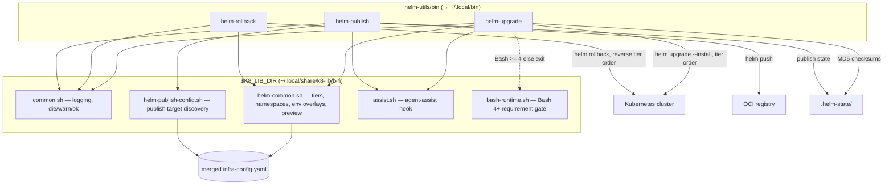

# helm-utils Architecture

## Overview

Terminal utility package providing the Helm chart lifecycle tooling for the Noizu k8s platform: dependency-ordered (tiered) upgrades with MD5 change detection (`helm-upgrade`), dependency-aware reverse-tier rollbacks (`helm-rollback`), and OCI chart packaging/publishing (`helm-publish`). Each tool is a standalone Bash script (`set -euo pipefail`) installed to `~/.local/bin` via `make install` (or repo-root `make install-utilities`, which also installs the shared k8-lib). `helm-upgrade` requires **Bash 4+** (gated by `bash-runtime.sh`; macOS's `/bin/bash` 3.2 is rejected) — `helm-rollback` and `helm-publish` have no such floor.

All three scripts source the shared shell library from `$K8_LIB_DIR` (default `~/.local/share/k8-lib`) rather than a relative sibling path, so they work from any working directory. Runtime configuration comes from the merged `infra-config.yaml` resolved relative to `$INFRA_ROOT` (default `$PWD`), overridable with `--config <file>` — the scripts pre-parse `--config` before sourcing k8-lib so the config path is honored during library initialization.

## System Diagram

## Core Components

| Component | Purpose |
|-----------|---------|
| `bin/helm-upgrade` | Tier-ordered `helm upgrade --install` with MD5 change detection, env overlays (`--env stage`, shorthands `--stage`/`--prod`/`--dev`), interactive toggle UI, `--headless` non-interactive mode, manifest preview/diff (`--preview`, `--preview-tool`), server-side-apply conflict auto-fix (`--force-conflicts`), and a **`--reset-values` default** (values.yaml authoritative) with a `helm_preserve_values` opt-out to `--reuse-values` |
| `bin/helm-rollback` | Reverse-tier rollback in three modes: explicit `--include`, auto-detect (unhealthy pods + recent deploys), or time-window `--back-to <duration>`; interactive plan editor |
| `bin/helm-publish` | Package + push charts to an OCI registry; auto-detect from CWD, `--pick`, `--all`, `--bump <level>`, `--dry-run`; auth resolved `K8_HELM_REGISTRY_PASSWORD` → `GITHUB_TOKEN` → `gh auth token` |
| `$K8_LIB_DIR/bin/*.sh` | Shared k8-lib: `common.sh` (colors/logging), `helm-common.sh` (tiers, namespace lookup, env overlays, preview, `helm_preserve_values` resolution), `helm-publish-config.sh` (publish target discovery), `assist.sh` (agent-assist hook), `bash-runtime.sh` (Bash 4+ requirement gate, sourced by `helm-upgrade`) |
| `.helm-state/` (in `$INFRA_ROOT`) | Per-release MD5 checksums (skip-unchanged for `helm-upgrade`), publish state (`last-publish`, `publishes`), and `upgrade-policy.yaml` (impact-confirmation policy) |
| `Makefile` | `make install` → `install -m 755 bin/*` to `$INSTALL_DIR` (default `~/.local/bin`) + bash/zsh completions from `completions/`; `compile`/`test` are no-ops |

## Configuration Model

Two distinct discovery paths against the same merged `infra-config.yaml`:

- **Deploy tools** (`helm-upgrade`, `helm-rollback`) discover chart directories from `paths.helm_dir`, `helm_scan_dirs`, and `chart_path_overrides`; deployment plan comes from `tiers[]`, with `namespace_overrides` and `timeout_overrides`.
- **Publish tool** (`helm-publish`) discovers publish targets from `project.helm.charts[]` (flat) or `project.projects[].helm.charts[]` (composite monorepo), each with optional per-chart `registry`; default registry from `helm.oci_registry` / `helm.registry_host`. Credentials come from `.envrc.k8.dc` or environment.

Environment overlays: `--env <name>` switches release names to `<env>-<chart>`, layers `values-<env>.yaml` over `values.yaml`, and restricts the plan to charts that have the overlay file.

## Data Flow

**helm-upgrade**: discover charts → apply namespace/env/include/exclude filters (optional interactive toggle UI) → compute MD5 checksums and skip unchanged (unless `--force`) → analyze manifest impacts → show plan table and confirm (`e` to edit) → execute tier-by-tier (tier 0 first), halting on tier failure → on SSA ownership conflicts optionally transfer field ownership and retry → persist checksums.

**helm-rollback**: mode dispatch (explicit / time-window / auto-detect) → build plan with target revisions → confirm or edit interactively → execute in reverse tier order (highest tier first).

**helm-publish**: resolve targets from config (or CWD auto-detect / `--pick` / `--all`) → optional version `--bump` → `helm package` → registry login → `helm push` to OCI, recording publish state.

## Key Design Decisions

- **MD5 change detection**: avoids redundant Helm releases; checksums are per-release, so env overlays (e.g. `stage-*`) track independently of production.
- **Tier-ordered execution**: infrastructure (tier 0) deploys before workloads; rollback reverses the order so app layers unwind before their dependencies.
- **k8-lib via `$K8_LIB_DIR`, not relative paths**: installed scripts run from anywhere; the library is a shared dependency of all Noizu k8 utilities, installed to `~/.local/share/k8-lib` by the monorepo root `make install-utilities`.
- **`--reset-values` default**: Helm's own default (`--reuse-values`) silently keeps one-off `--set` values from months ago, so a bumped image tag in `values.yaml` gets ignored. `helm-upgrade` forces `--reset-values` so committed values are what is live; charts whose live releases carry runtime-generated state absent from `values.yaml` (Weaviate/Qdrant cluster keys, generated secrets) opt out via the `helm_preserve_values` list in `infra-config.yaml` and get `--reuse-values` instead.
- **`--config` pre-parse before sourcing**: k8-lib reads config during load, so the flag is scanned ahead of normal argument parsing.
- **Minimal dependencies**: Bash + helm 3.x (OCI-capable) + kubectl + jq + yq; no compiled components.

## Ecosystem Fit

Part of the Noizu monorepo utilities fleet (`Portfolio/Utilities/source/*`, a git submodule; the former repo-root `utilities/` dual-path registration no longer exists). The repo root's `.infra-config.yaml` is the production config these tools consume there (tiers 0–9, `namespace_overrides`, `chart_path_overrides`); `helm-upgrade` is the deploy step invoked by `deploy-service` and after `docker-push --release` bumps chart values. The Helm charts themselves live in the upstream `noizu-infra` repo — this package only orchestrates them.

## Project Layout & Related Docs

See [PROJ-LAYOUT.md](PROJ-LAYOUT.md) for the full tree: `bin/` (three executables), `completions/` (bash + zsh), `docs/`, `Makefile`, `README.md` (usage + full config reference).

- [PROJ-SCHEMA.md](PROJ-SCHEMA.md) — state-file formats, `infra-config.yaml` surfaces, env/secret structure (no persistence layer)
- [PROJ-HOWTO.md](PROJ-HOWTO.md) — task guides (`docs/howto/`: add a chart to the pipeline, deploy with an environment overlay)
- [PROJ-FAQ.md](PROJ-FAQ.md) — frequently asked questions
